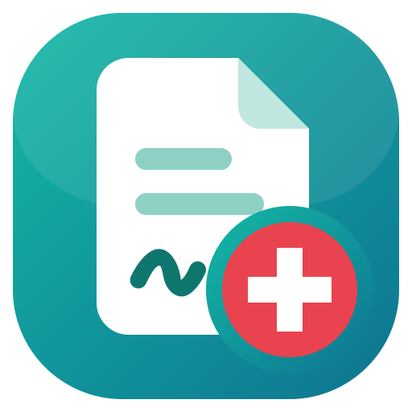

# KSK Doanh nghiệp

Ứng dụng Windows hỗ trợ **khám sức khỏe cho doanh nghiệp**: mở danh sách nhân viên công ty gửi (Excel, PDF – cả bản
quét) → tạo file nhập EHC, giấy khám sức khỏe cả đoàn; lịch khám theo ngày dùng chung giữa các máy; báo giá → file dịch
vụ doanh nghiệp chọn; tra mã số thuế, địa chỉ doanh nghiệp; tự điền mã xã/phường, tỉnh/TP theo **địa giới hành chính
mới (từ 01/07/2025)** – nhận cả địa chỉ mới lẫn địa chỉ cũ. Thông tin nhân viên chỉ xử lý trên máy.

(Trước đây tên là "Chuyển đổi mã xã phường".)

Tác giả: **NHL** · Phiên bản mới nhất: xem [Releases](https://github.com/NHL08/chuyen-ma-xa-phuong-releases/releases/latest)

## Tải về

- **Bộ cài (khuyên dùng):** [CaiDat_ChuyenDoiMaXaPhuong.exe](https://github.com/NHL08/chuyen-ma-xa-phuong-releases/releases/latest/download/CaiDat_ChuyenDoiMaXaPhuong.exe) – chạy rồi bấm Tiếp → Cài đặt.
  Không cần quyền quản trị; tạo lối tắt ở menu Start và Desktop; gỡ trong Cài đặt → Ứng dụng.
- Bản chạy ngay, không cần cài: [DienMaXaPhuong.exe](https://github.com/NHL08/chuyen-ma-xa-phuong-releases/releases/latest/download/DienMaXaPhuong.exe)
- Bản thư mục (khởi động nhanh): [DienMaXaPhuong_ban_thu_muc.zip](https://github.com/NHL08/chuyen-ma-xa-phuong-releases/releases/latest/download/DienMaXaPhuong_ban_thu_muc.zip)

Lần đầu chạy, Windows có thể hiện "Windows protected your PC" (bộ cài chưa ký số) → **More info → Run anyway**.

## Cập nhật

Ứng dụng tự kiểm tra phiên bản mới khi mở và trong lúc đang dùng; bấm **Cập nhật ngay** là tự tải, kiểm tra mã SHA-256
và cài.

## Nguồn phát hành (JSON)

- [`nguon.json`](https://github.com/NHL08/chuyen-ma-xa-phuong-releases/releases/latest/download/nguon.json) – thông tin ứng dụng và lịch sử các phiên bản
- [`latest.json`](https://github.com/NHL08/chuyen-ma-xa-phuong-releases/releases/latest/download/latest.json) – dùng cho tính năng tự cập nhật trong ứng dụng

Repo này chỉ chứa các bản phát hành; mã nguồn được lưu riêng.
